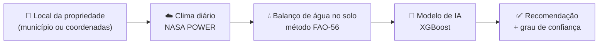

<div align="center">


# HidroDecisão

**Sistema inteligente de suporte à decisão para gestão hídrica em propriedades rurais**

Diz ao produtor se é hora de irrigar a lavoura, usando o clima do lugar, o solo e a cultura.

[](https://hidrodecisao.onrender.com)

</div>

---

## 📌 Sobre o projeto

Em muitas propriedades, a decisão de irrigar ainda é tomada "no olho": pelo calendário, pela aparência da planta ou pela experiência. Irrigar demais desperdiça água e energia; irrigar de menos derruba a produtividade. E a irrigação responde por uma parcela significativa das demandas de uso da água no Brasil (ANA, 2021).

O **HidroDecisão** é um protótipo acadêmico de **baixo custo**: não precisa de sensores nem de equipamentos, só de **dados públicos de clima**. O produtor informa a cultura, o solo e as datas, escolhe onde fica a propriedade, e recebe uma de três respostas:

| | Resposta | O que significa |
|---|---|---|
| 🟢 | **Sem necessidade de irrigação** | O solo ainda tem água suficiente |
| 🟡 | **Atenção: irrigação em breve** | A água está acabando; planeje a irrigação |
| 🔴 | **Irrigação recomendada** | A planta está entrando em estresse hídrico |

Junto com a resposta, o site mostra **quantos milímetros irrigar** e avisa se o resultado é **confiável** ou **incerto**.

> O sistema **apenas recomenda**: não controla equipamentos e não garante economia de água. A decisão continua sendo do produtor.

**🌐 Teste agora:** https://hidrodecisao.onrender.com

---

## ⚙️ Como funciona



1. **Clima do lugar.** Para o ponto escolhido, o sistema busca chuva, temperatura, umidade, vento e radiação de cada dia na [NASA POWER](https://power.larc.nasa.gov/). A localização de municípios e a altitude vêm do [Open-Meteo](https://open-meteo.com/).
2. **Balanço de água (FAO-56).** O solo funciona como uma caixa d'água: chuva e irrigação enchem, a planta consome. Dia a dia desde a semeadura, o método [FAO-56](https://www.fao.org/4/x0490e/x0490e00.htm) calcula quanto falta para o solo ficar cheio (o *déficit*).
3. **Modelo de IA.** Um classificador XGBoost, treinado com 675 safras simuladas, classifica a necessidade de irrigação a partir do clima recente, da cultura, do solo e da última irrigação.
4. **Recomendação.** O site mostra a resposta em linguagem simples, com letras grandes, pensando em usuários mais velhos. Os detalhes técnicos ficam guardados em botões, para quem quiser conferir.

O modelo foi treinado com o clima de **Passo Fundo – RS**. Em outras regiões (a mais de 50 km) ou em datas de junho a setembro, o resultado principal passa a ser o **cálculo FAO-56**, que vale em qualquer lugar, e o site avisa isso na tela.

---

## 📊 Resultados

**Dados de treino:** 675 safras simuladas (15 anos × 5 datas de semeadura × 3 culturas × 3 solos), com clima real de Passo Fundo de 2010 a 2024, somando 52.650 dias rotulados pelo FAO-56. A divisão é **por ano**, para testar em anos que o modelo nunca viu:

| Treino | Validação e calibração | Teste |
|:---:|:---:|:---:|
| 2010–2019 | 2020–2021 | 2022–2024 |

**Comparação de modelos** (F1-macro no teste; 1 = perfeito):

| Modelo | F1-macro | Acurácia balanceada |
|---|:---:|:---:|
| **XGBoost (escolhido)** | **0,864** | **0,858** |
| Random Forest | 0,850 | 0,849 |
| Rede neural (MLP) | 0,840 | 0,832 |
| Regressão logística | 0,741 | 0,749 |
| Chute fixo (Dummy) | 0,227 | 0,333 |

O modelo foi escolhido pela validação, sem olhar o teste. Tabela completa em [`reports/metricas.csv`](reports/metricas.csv).

**Intervalos de predição (predição conformal, 90% de confiança):** em vez de uma resposta só, o modelo devolve o conjunto de respostas possíveis. No teste, a resposta certa ficou dentro do conjunto em **93,5%** dos casos (meta: 90%), e **86%** dos resultados saíram com uma resposta só ("Resultado confiável"). Detalhes em [`reports/conformal.csv`](reports/conformal.csv) e na página **Metodologia** do site.

---

## 🧰 Tecnologias

| Camada | Ferramentas |
|---|---|
| Site | Flask, Jinja2, HTML, CSS e JavaScript puro |
| Dados e cálculos | pandas, NumPy, método FAO-56 (Penman-Monteith) |
| Machine Learning | scikit-learn, XGBoost, predição conformal própria (`hidrica/conformal.py`) |
| Gráficos | Matplotlib |
| Hospedagem | Docker, gunicorn, Render; testes no GitHub Actions |
| Fontes de dados | NASA POWER (clima), Open-Meteo (municípios e altitude) |

---

## 🚀 Como rodar no seu computador

Pré-requisito: **Python 3.14** (se alguma biblioteca não instalar, use o 3.12).

```bash
# 1. Criar o ambiente e instalar as dependências
py -3.14 -m venv .venv
.venv\Scripts\python -m pip install -r requirements-dev.txt

# 2. Abrir o site
.venv\Scripts\python app.py
```

Acesse **http://127.0.0.1:5000**. O modelo treinado já vem no repositório (`models/`), então não é preciso treinar para usar.

<details>
<summary><b>Retreinar o modelo</b></summary>

```bash
.venv\Scripts\python scripts/pipeline.py
```

Baixa o clima da NASA POWER desde 2010, simula as safras, gera o dataset, treina e compara os modelos e calibra os intervalos de predição (cerca de 3 minutos). Opções:

- `--clima-sintetico`: usa clima gerado artificialmente, sem internet.
- `--so-treino`: reaproveita o `data/dataset.csv` e só retreina e recalibra.

Para atualizar só o clima salvo: `python scripts/atualizar_clima.py`.
</details>

<details>
<summary><b>Rodar os testes</b></summary>

```bash
.venv\Scripts\python -m pytest
```

Os testes não dependem da internet: usam clima sintético. Eles também rodam no GitHub a cada envio.
</details>

<details>
<summary><b>Publicar na internet</b></summary>

O site é uma única aplicação Flask (interface e API juntas), por isso precisa de uma hospedagem que rode Python; o GitHub Pages não serve. O repositório já traz `Dockerfile`, `render.yaml` e `wsgi.py`. Passo a passo em [`docs/DEPLOY.md`](docs/DEPLOY.md).
</details>

---

## 📁 Estrutura do projeto

```
├── app.py                 # site Flask: páginas, formulário e API
├── config.py              # culturas, solos, anos de treino e outras constantes
├── hidrica/               # o "cérebro" do sistema
│   ├── clima.py           #   busca e atualização do clima (NASA POWER)
│   ├── localidade.py      #   municípios, coordenadas e altitude (Open-Meteo)
│   ├── agro.py            #   cálculos FAO-56 (ET0, Kc, água do solo)
│   ├── dataset.py         #   simulação das safras e balanço de água
│   ├── modelo.py          #   treino e comparação dos modelos
│   ├── conformal.py       #   intervalos de predição
│   └── recomendacao.py    #   validação do formulário e resultado da análise
├── templates/  static/    # telas do site (HTML, CSS, JS, fotos)
├── models/                # modelo treinado e seus metadados
├── reports/               # métricas e resultados da calibração
├── scripts/               # retreinar o modelo e atualizar o clima
├── tests/                 # testes automatizados (pytest)
└── docs/                  # especificação, deploy e documentos do projeto
```

---

## ⚠️ Limitações

- **Os rótulos são simulados.** Não existe uma base real de "precisa irrigar": os exemplos de treino vêm do balanço FAO-56. Por isso, as métricas medem a **concordância com o FAO-56**, e não o acerto em campo. Não houve validação em campo.
- **Um único local de treino.** O modelo conhece o clima de Passo Fundo; nas outras regiões o resultado principal é o cálculo FAO-56.
- **Parâmetros de referência.** Kc, estágios, raízes e solos vêm das tabelas do FAO-56 e ainda precisam ser conferidos ([`docs/spec.md`](docs/spec.md), seção 5).
- **Clima regional e com atraso.** A NASA POWER é uma estimativa de satélite em grade de cerca de 50 km, com alguns dias de atraso; não é uma medição na propriedade.
- O balanço supõe o solo cheio na semeadura, chuva totalmente aproveitada e sem subida de água do lençol freático.

---

## 👥 Equipe


- Alisson de Morais Bosa · *Gestor Técnico*
- Júlia de Lima Miranda · *Gestora de Projeto*
- Carlos Eduardo Tonhelski Oliveira
- Júlia Wonsick Pazzinatto
- Maria Carolina Pegoraro
- João Vinicius Lago dos Santos
- Renan Terre Gomes
